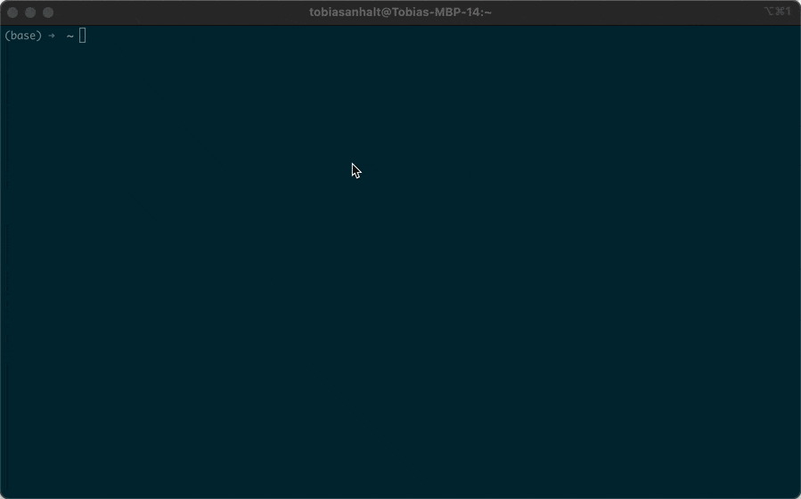

# Hack Your Brain with Bash: Program Your Habits

Inspired by James Clear's "Atomic Habits," this hackable Bash script is your toolkit for programming your brain to build better habits.

It is the result of living a productive life as programmer with ADHS. Trust me, its hard.



## Ready modes
- **Zen Mode**: `hack switch zen` - Blocks everythign distracting
- **News Timer**: `hack switch news` - Solve challenges and get some news & social media time
- **Work Mode**: `hack switch work` - Unblocks all work related messengers
- **Clear Mode**: `clear` - Unblocks everything after solving challenges

## Atomic Habits Principles
This script is a practical application of the principles from "Atomic Habits":

- **Cue Elimination**: Zen Mode removes the triggers of bad habits and lets you focus on the task at hand.
- **Increase friction of bad habits**: In order to access social media and instant messages you get to complete challenges first
- **Make good habits easy**: The script always brings you back to zen so being in the flow without distractions becomes your new normal. 
- **Identity Reinforcement**: Each use is a vote for the person you're becoming.
  "Every action you take is a vote for the type of person you wish to become." – James Clear

## Installation & commands
On Ubuntu/Debian, install dependencies with:

```bash
sudo apt-get install bash bc fswatch screen util-linux acl
```

The installer grants only your user write access to `/etc/hosts` and preserves an
existing `hack.sh` when run again. Personal configuration and runtime state are
ignored by Git. Downloads use HTTPS, so no GitHub SSH key is needed.

1. Install the script:
   ```bash
   curl -sL https://raw.githubusercontent.com/Mythli/hack-your-brain-with-bash/main/src/download.sh | bash
   ```
2. Personalize your habit plan:
   ```bash
   hack edit
   ```
3. Engage Zen Mode for focus:
   ```bash
   hack switch zen
   ```
4. Start hacking your brain
   ```bash
   hack edit vim
   ```
5. List all modes
   ```bash
   hack list
   ```

5. Print mode information
   ```bash
   hack print zen
   ```

## Temporary allowances and enforcement

```bash
hack switch zen
hack allow youtube       # Default: 30 minutes, after three addition challenges
hack allow slack 10      # Allow matching app rules for 10 minutes
hack status              # Current mode and remaining allowances
```

`allow` matches entries whose names contain the supplied text, ignoring case.
Matching is literal: characters such as `.` and `*` are not regular expressions
or wildcards. It searches the current mode's `hosts`, `closed_apps`, and
`suppressed_apps`. Failed challenges and queries with no matches change nothing.
Already closed apps are not reopened automatically.

Configure these settings through `hack edit`:

```bash
allow_default_duration=30
allow_max_duration=60
allow_challenges="addition3 addition3 addition3"
```

`addition3` asks you to add two three-digit numbers, with three attempts per
problem. The default allow, clear, and news challenge lists each require three
problems (for example, `123 + 456`). The challenge list uses the same configurable functions as mode challenges. Each
new allowance, including an extension, requires the challenge again. Allowances
expire at their deadline or on any mode switch, whichever comes first. Switching
back to the same mode starts a new activation with no allowances.

One detached `screen` worker per active mode uses `fswatch` to watch the hosts
directory and the runtime state directory. Watching the parent directory also
catches editors that save by replacing the hosts file. On a change, it rebuilds
the managed hosts block from the mode's hosts minus currently allowed matches.
It writes only when the result differs, avoiding a loop from its own events.
Unrelated hosts entries outside the managed block are preserved. The writer also
repairs the legacy missing/glued end marker and uses valid comment markers.

App suppression reads the same allow list every ten seconds. A one-second timer
check handles allowance and mode expiry even when no file changes. Deadlines use
wall time, so sleep does not extend them; expired rules are reapplied on resume.
Mode switches and allowances are serialized, and old mode workers cannot write
after a new activation. If `fswatch` exits, the worker logs the failure and falls
back to checking hosts once per second.

Dependencies: Bash 4.3+, `fswatch`, `screen`, and `flock` (Linux) or `shlock`
(included on macOS), in addition to the original math utilities. On macOS,
install the watcher with `brew install fswatch` if needed. Existing installations
start the new worker on their next `hack switch`. Runtime state lives in the
ignored `.hack-state/` directory. This retains the existing `screen` lifecycle:
it survives closing a terminal, but is not a login/boot service. After a reboot,
run `hack switch` to resume enforcement. `hack allow` also restarts a missing
worker for a recorded, unexpired mode before granting an exception.

Hosts changes affect subsequent name resolution; established browser connections
can remain open. App rules still use whitespace-separated names in the mode
configuration, matched against process executable names/paths.

Run the integration tests with `python3 -m unittest discover -s tests -v`.
They use temporary hosts/state files and record app closures without killing apps.

## Hackable Features
- Customize with `hack edit` to block any app or site.
- Comes with over 50,000 distracting domain names which you can use
- Comes with 3 challenge types: Mantra completion, Math and physical exercises.
- Hack challenges and rewards to fit your goals. The sky is the limit.

"Habits are the compound interest of self-improvement." – James Clear

## Have an idea?
PRs welcome.
